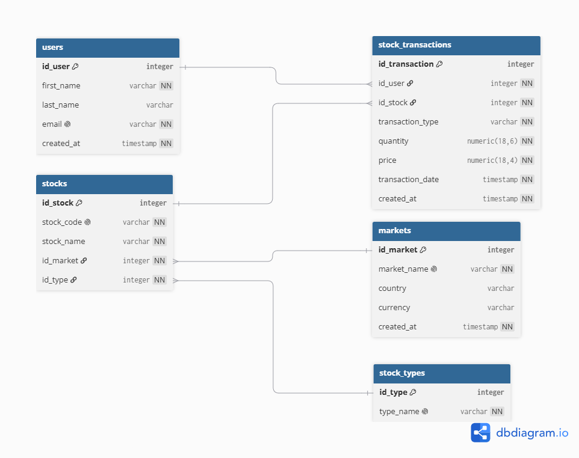

# Arquitetura e evolução
## Arquitetura

O pipeline é dividido em duas partes: ingestão e transformação/consumo.

**Ingestão**
- O usuário envia um JSON com seu e-mail e as transações de compra/venda (símbolo, quantidade, preço, data).
- A brapi.dev fornece o catálogo de ativos negociados (nome, setor, tipo, mercado) e as cotações.
- Operações e catálogo alimentam o OLTP. A coleta periódica de mercado seguirá diretamente para o armazenamento bruto do lakehouse, sem CDC. O agendamento será feito pelo Airflow.
- O Postgres propaga mudanças via CDC (Debezium) para o Redpanda (compatível com a API do Kafka), que alimenta a camada Bronze do lakehouse.

**Transformação e consumo**
- Bronze (Iceberg): dados brutos, como chegaram da origem.
- Silver (Iceberg): dados validados e conformados, processados com Spark em Scala.
- Gold (Iceberg): métricas de negócio (rendimento da carteira ao longo do tempo), modeladas com dbt.
- A camada Gold é consumida por um dashboard e por um agente de insights baseado em LLM.
- O Airflow orquestra as etapas do pipeline (ingestão agendada, jobs Spark, execução do dbt).

## Stack técnica

| Camada | Tecnologia |
|---|---|
| Banco transacional (OLTP) | PostgreSQL |
| Captura de mudanças (CDC) | Debezium |
| Streaming | Redpanda |
| Formato de tabelas do lakehouse | Apache Iceberg |
| Processamento Bronze/Silver | Apache Spark (Scala) |
| Transformação Gold | dbt |
| Orquestração | Apache Airflow |
| Dashboard | Streamlit |
| Agente de insights | LLM sobre a camada Gold |
| Ingestão (scripts) | Python |
| Gerenciamento de dependências Python | Poetry |
| Ambiente local | Docker Compose |

## Estrutura do projeto

```
yntd_kobosil/
    docker/
        docker-compose.yml
        init/                  schema SQL aplicado na primeira subida do Postgres
        connectors/            configuração do conector Debezium e arquivo de secrets
    ingestion/
        catalog/               sincroniza o catálogo de ativos a partir da brapi.dev
        portfolio/              carrega as transações que o usuário envia
    spark/                     jobs Bronze -> Silver (Scala)
    dbt/                       modelos Silver -> Gold
    orchestration/
        airflow/                DAGs de orquestração
    dashboard/                 aplicação Streamlit
    agent/                      agente de insights
    docs/
        architecture/            diagramas de arquitetura
        der/                     modelo de dados do OLTP
    pyproject.toml
    Makefile
    .env.example
```

## Modelo de dados

O banco OLTP é composto por cinco tabelas, normalizadas até a terceira forma normal: `users`, `markets`, `stock_types`, `stocks` e `stock_transactions`. A tabela `stock_transactions` funciona como um histórico de movimentos (o schema não impõe append-only) de compras e vendas, o que permite reconstruir a posição da carteira em qualquer data no processamento posterior, em vez de armazenar apenas o estado atual.



## Status e roadmap

Concluído:
- Modelagem e schema do banco OLTP
- Ambiente Docker local com Postgres, Redpanda e Debezium Connect
- Captura de mudanças (CDC) validada ponta a ponta
- Sincronização do catálogo de ativos a partir da brapi.dev, com paginação e cache local
- Carga de transações do usuário, com resolução de usuário por e-mail e de ativos por símbolo

Em andamento ou pendente:
- Ingestão de dados de cotação, dividendos e balanços a partir da brapi.dev
- Jobs Spark para as camadas Bronze e Silver em Iceberg
- Modelos dbt para a camada Gold
- Orquestração com Airflow
- Dashboard
- Agente de insights
- Preparação para deploy em nuvem (AWS ou GCP)


